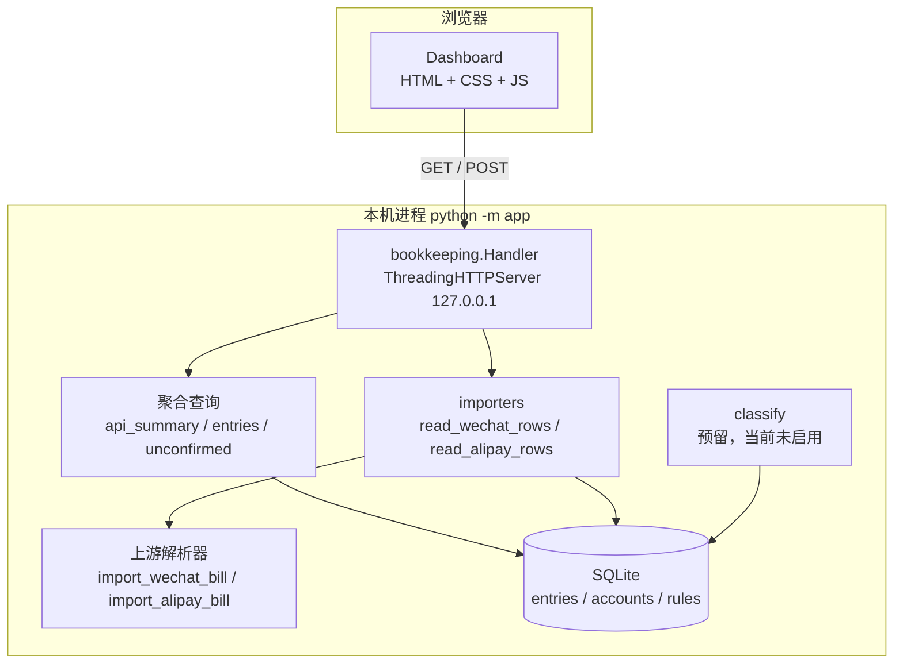
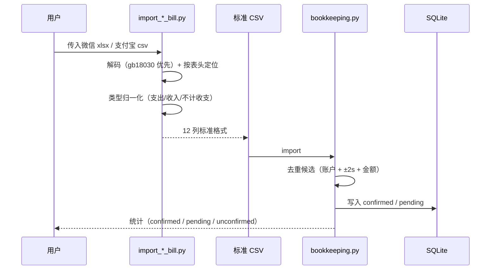

# 架构

> 状态：**已实现**。应用位于 `app/`，fork 自 `bingchuH/Bookkeeping`（MIT）。

## 分层

## 一次导入的数据流

## 模块边界

| 模块 | 拥有 | 不得拥有 |
|---|---|---|
| `app/bookkeeping.py` | schema、入库、去重、规则、聚合、HTTP 与静态托管 | 账单格式差异（交给解析器） |
| `app/importers.py` | 字段归一化、金额转分、类型语义 | 数据库写入、HTTP |
| `app/import_*.py` | 各数据源的解码、表头识别、中性映射 | 聚合口径 |
| `app/classify.py` | 提示词、模型调用、枚举与置信度校验 | 入库、路由、聚合 |
| `app/bookkeeping_app/static/` | 渲染与交互 | 任何统计计算 |

## 关键不变量

1. 金额以整数分存储；解析器用 `Decimal` 换算，不用浮点。
2. 中性交易类型为 `不计收支`：入库可见，但不进入收入/支出合计（聚合按类型白名单）。
3. 重复导入不产生重复记录：账户 + 时间差 ≤2 秒 + 金额相等。
4. 分类结果落库；规则优先，模型只处理未命中项。
5. 模型不可用时 `classify-pending` 返回码 2 并显式打印降级原因。

## 与上游的差异

- 新增 `不计收支` 类型（上游会丢弃未映射的中性交易）。
- `read_wechat_xlsx()` 接受 bytes。
- 静态资源与配置路径同时兼容 `app/` 与上游 `scripts/` 布局。

## 尚未确定

- 类目体系尚未按调研结论裁剪（当前沿用上游三级结构）。
- 跨平台重复（微信 ↔ 支付宝 ↔ 银行卡）未配对。
