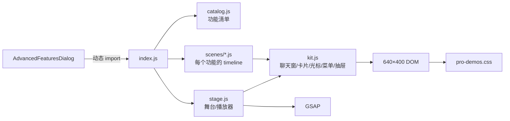

# 动态功能演示（Pro Demos）实现指南

> 目标：把「左侧功能清单 + 右侧 640×400 自动播放动画」这套机制，移植到另一个应用的功能介绍弹窗里。
>
> 参考实现：`frontend/lib/pro-demos/`、`frontend/assets/css/pro-demos.css`、`frontend/components/AdvancedFeaturesDialog.vue`。
>
> 一句话：**不是视频/GIF，而是 DOM + SVG + CSS + GSAP timeline 的程序化演示。**

---

## 1. 它是什么

这套东西解决的是：

> 一个功能还没做完，或者不方便让用户直接操作，怎么让用户快速看懂「它是什么、怎么用、边界在哪」？

做法不是录屏，而是：

```text
左侧：catalog.js 里的功能清单
右侧：stage.js 驱动的演示舞台
舞台里：每个功能一个 scene 脚本
scene 用 kit.js 搭出 App/微信界面
再用 GSAP timeline 编排点击、打字、弹窗、结果
```

最终效果：

- 自动逐条播放；
- 点左侧清单立即切换；
- 每条 4.5–7.5 秒；
- 底部有进度线；
- 页面隐藏/滚出视口自动暂停；
- 支持 `prefers-reduced-motion`。

---

## 2. 效果拆解

以截图里的「修改文字消息」为例：

```text
1. 顶部情境条：按截图核对 · 这句话改错了
2. 模拟微信聊天窗出现
3. 光标移到错误气泡
4. 右键菜单弹出
5. 选「修改文字」
6. 光标点击输入区
7. 逐字打出正确句子
8. 点发送
9. 气泡闪一下，挂「已修改」标签
10. 右下盖章：已写入 message_0.db
11. 情境条右侧给出结果：和截图对上了
12. 停 0.9 秒，自动切下一条
```

它不是“随便动几下”，而是一个完整的小故事：

```text
问题 → 操作 → 结果
```

---

## 3. 架构



职责：

| 文件 | 职责 |
|---|---|
| `catalog.js` | 功能清单、分组、标题、说明、步骤、边界 |
| `index.js` | 汇总 scenes，导出 `createProPanel` |
| `stage.js` | 640×400 缩放、自动播放、切换、进度、暂停 |
| `kit.js` | 可复用的 UI 积木和基础动画 |
| `scenes/*.js` | 每个功能的具体动画编排 |
| `pro-demos.css` | 暗色 HUD、扫描光、光标、骨架、按钮等样式 |
| `AdvancedFeaturesDialog.vue` | 弹窗容器、动态加载、开关 |

---

## 4. 数据模型：catalog

每个功能是一条 item：

```js
{
  key: "edit-source",
  name: "编辑消息源码",
  caption: "打开消息的 XML 源码，逐字段手改。",
  use: "卡片修复",
  need: "恢复回来的链接卡片标题乱码，改源码让它可读",
  story: "恢复回来的链接卡片，标题成了一串乱码……",
  flow: ["打开消息源码", "逐字段改回可读", "存回微信"],
  edge: "直接修改电脑和手机微信 · 可随时还原",
  local: true,
  overview: false
}
```

字段用途：

| 字段 | 用在何处 |
|---|---|
| `key` | scene 索引，必须与 `scenes` 的 key 一致 |
| `name` | 左侧清单、HUD 标题 |
| `caption` | 一句话“怎么做” |
| `use` | 短标签，HUD 右上角 |
| `need` | 底部说明行“为什么需要它” |
| `story` | 场景脚本的叙事依据，不一定上屏 |
| `flow` | 3 步流程，给 overview 场景用 |
| `edge` | 边界/风险，情境条或底部说明 |
| `local` | 是否回写本地数据 |
| `overview` | 没有独立 scene 时，用通用说明页兜底 |

分组：

```js
export const PRO_GROUPS = [
  { key: "edit", label: "消息修改", tag: "EDIT", items: [...] },
  { key: "action", label: "微信动作", tag: "SEND", items: [...] },
  ...
]
```

---

## 5. 舞台引擎：stage.js

### 5.1 固定 640×400

```js
export const SCREEN_W = 640;
export const SCREEN_H = 400;
```

`stage.js`：

```js
const fit = () => {
  const w = box.clientWidth || SCREEN_W;
  const s = w / SCREEN_W;
  screen.style.transform = `scale(${s})`;
  box.style.setProperty("--pd-scale", s);
};
```

好处：

- 所有场景按 640×400 写死坐标；
- 换容器大小只改一个 `transform: scale()`；
- 不需要给每个场景写响应式断点；
- 截图/导出时尺寸稳定。

### 5.2 自动播放

```js
const mountScene = (item, my) => {
  clearScene();
  const kit = createKit(gsap, screen, { reduced });
  const tl = gsap.timeline({ paused: true });
  const sceneTl = scene({ gsap, root: screen, kit, tl, reduced, item });

  const run = gsap.timeline({ paused: true, onComplete: scheduleNext });
  run.add(sceneTl, 0);
  run.fromTo(bar, { scaleX: 0 }, { scaleX: 1, duration: sceneTl.duration(), ease: "none" }, 0);
  run.play(0);
};
```

播完：

```js
pending = gsap.delayedCall(hold, () => next());
```

默认 `hold = 0.9` 秒。

### 5.3 切换

```js
show(key) {
  // 旧场景暂停
  if (run) run.pause();

  // 扫描光 + 淡出
  const out = gsap.timeline();
  out.fromTo(sweep, { xPercent: -100, opacity: 1 }, { xPercent: 100, duration: 0.5 })
    .to(screen, { opacity: 0, duration: 0.2 }, 0.1)
    .call(() => mountScene(item), [], 0.34);
}
```

### 5.4 暂停

- 页面隐藏：`visibilitychange`
- 滚出视口：`setActive(false)`
- 手动：`pause()` / `resume()`

```js
const syncPause = () => {
  const shouldRun = active && !userPaused && !destroyed;
  if (run) shouldRun ? run.play() : run.pause();
  if (pending) shouldRun ? pending.play() : pending.pause();
};
```

### 5.5 调试/截图

```js
seek(t) {
  userPaused = true;
  run.pause();
  run.seek(Math.min(t, run.duration()), false);
}
```

可以定格到任意秒，方便截图/验收。

---

## 6. 动画积木：kit.js

`kit.js` 是核心复用层。场景只负责“摆积木 + 编时间轴”，不直接写底层样式。

### 6.1 基础动画

```js
K.type(el, text, { cps: 16 })       // 逐字打字
K.scramble(el, text, { duration })  // 乱码滚动后落定
K.count(el, to, { duration })       // 数字滚动
K.pop(el) / K.fade(el)              // 入场/淡入
K.flash(el, { color: "amber" })     // 闪烁
K.ok("已写入", { en: "WRITTEN" })   // 右下盖章
```

### 6.2 光标

```js
const c = kit.cursor();
c.show();
c.to(target);
c.click(target);
c.tap(target);
c.hide();
```

内部是 `gsap.to` + 环形波纹。

### 6.3 聊天窗

```js
const chat = kit.chat({
  title: "小满",
  railNames: ["家人群", "老同学", "室友"],
});

chat.time("2024-08-09 21:40");
chat.row("l", "你上次说几号来", { av: "满" });
chat.row("r", "我十九号下午两点到");
chat.row("l", "好，九号那天我去接你", { av: "满" });
```

`chat` 返回：

```js
{
  el, rail, main, head, title, more, list, input, field, tools, send, sessions,
  row(), rowAt(), time(), sys()
}
```

### 6.4 菜单/抽屉/表单/代码

```js
const menu = kit.menu([...], { at: target, dx: 14, dy: 6 });
menu.open();
menu.hover(1);
menu.close();

const sheet = kit.sheet({ title: "消息源码 · XML" });
sheet.open();
sheet.close();

const form = kit.form([
  ["display_time", "1970-01-01 08:00", true],
  ["create_time", "0", true],
]);

const code = kit.code([
  "<appmsg>",
  "  <title>...</title>",
  "</appmsg>",
], sheet.body);
```

### 6.5 情境条/工作流

```js
const strip = kit.scenario("恢复回来的卡片标题乱码", { local: true });
strip.in();
strip.result("卡片标题恢复可读");

const flow = kit.workflow(["触发", "取件", "执行"]);
flow.in();
flow.step(0);
flow.done();
```

### 6.6 双窗口（发送类场景）

```js
const twin = kit.twin({ title: "客户 · 王总" });
twin.fly(twin.appChat.send, twin.wxChat.list);
```

左窗是“本应用”，右窗是“真实微信”，光点飞过去表示真的发出去了。

---

## 7. 场景脚本规范

### 7.1 统一签名

```js
export default function myScene({ gsap, kit, tl, root, reduced, item }) {
  // 1. 用 kit 摆界面
  // 2. 把所有动画挂到 tl
  // 3. return tl
  return tl;
}
```

### 7.2 规则

1. **所有补间必须挂在 `tl` 上**，不要裸调 `gsap.to`。
   - 舞台切换时靠 `kill(tl)` 清场。
   - 裸补间会泄漏到下一个场景。

2. **不要用 `window.gsap` 或裸 `gsap` 标识符**。
   - 从参数取 `gsap`，方便官网/应用注入不同实例。

3. **每条场景 4.5–7.5 秒**。
   - 太短讲不清，太长自动播放会拖沓。

4. **结尾用 `kit.ok()` 盖章并停留 ≥0.9 秒**。
   - 给观众一个“完成了”的落点。

5. **顶部必须有 `kit.scenario()`**。
   - 先交代“此刻发生了什么”，否则观众不知道为什么要操作。

6. **回写类场景加 `{ local: true }`**。
   - 明确告诉用户：直接改本机微信、可还原。

7. **真实动作类场景用 `kit.workflow()`**。
   - 表示“不是人在点，是工作流自动跑”。

8. **不要动画 `height`/`width`**。
   - 用 `transform`/`opacity`，避免整页 reflow。

9. **隐藏节点先用 `display:none`**，再 `fromTo` 显示。
   - 否则会在显示瞬间闪一下。

10. **坐标用 `kit.rect()` 换算**。
    - 场景根被外层 `scale()` 缩放，直接读 `getBoundingClientRect()` 会拿到屏幕坐标。

---

## 8. 案例：修改文字消息

`scenes/edit.js` 的 `editText`：

```js
function editText({ kit, tl }) {
  const chat = myChat(kit);
  const strip = kit.scenario("按截图核对 · 这句话改错了", { local: true });

  chat.time("2024-08-09 21:40");
  chat.row("l", "你上次说几号来", { av: AV });
  const mine = chat.row("r", "我十九号下午两点到"); // 错误版本
  chat.row("l", "好，九号那天我去接你", { av: AV }); // 上下文坐实原话

  const target = mine.content;
  const c = kit.cursor();

  const menu = kit.menu([
    { icon: "edit", label: "修改文字" },
    { icon: "code", label: "编辑源码" },
    { icon: "clock", label: "修改时间" },
    { icon: "trash", label: "删除", danger: true },
  ], { at: target, dx: 14, dy: 6 });

  tl.add(strip.in(), 0.1)
    .add(c.show(), 0.25)
    .add(c.tap(target), 0.35)
    .add(menu.open(), ">-0.05")
    .add(c.to(menu.items[0], { duration: 0.35 }), ">")
    .call(() => menu.hover(0))
    .add(c.click(menu.items[0]), ">")
    .add(menu.close(), ">")
    .call(() => target.classList.add("is-edit"))
    .add(kit.type(target, "我九号下午两点到", { cps: 12 }), ">+0.1")
    .add(c.to(chat.send, { duration: 0.4 }), ">+0.2")
    .add(c.click(chat.send), ">")
    .call(() => {
      target.classList.remove("is-edit");
      target.appendChild(kit.tag("已修改"));
    })
    .add(kit.flash(target, { color: "amber", duration: 0.6 }), "<")
    .add(kit.ok("已写入 message_0.db"), ">-0.2")
    .add(strip.result("和截图对上了"), "<")
    .add(c.hide(), "<");

  return tl;
}
```

拆解：

```text
0.1s  情境条进入
0.25s 光标出现
0.35s 光标点错误气泡
0.4s  右键菜单展开
0.6s  光标移到「修改文字」
0.9s  点击
1.0s  菜单收起，气泡进入编辑态
1.1s  逐字打出正确句子
2.5s  光标移到发送
3.0s  点击发送
3.1s  气泡挂「已修改」标签 + 琥珀闪烁
3.3s  右下盖章
3.4s  情境条右侧给出结果
3.6s  光标退场
4.0s  停住，等待自动切下一条
```

---

## 9. 设计规范

### 9.1 视觉语言

- 暗色终端 HUD；
- 霓虹绿 `#3df28d`，琥珀 `#ffc24b`，红 `#ff5d5d`；
- 等宽字体做标签/编号；
- 扫描光、四角定位线、噪点、网格；
- 不要大面积渐变、玻璃拟态过度。

### 9.2 信息层级

```text
顶部：OP 序号 / 分组 / PRO 标签
情境条：发生了什么 / 本地写入提示
主画面：模拟 App 界面
底部：功能名 / 使用场景 / 说明行
右下：成功印章
底部细线：播放进度
```

### 9.3 叙事

每个场景都要回答三个问题：

1. **为什么做？**（情境条）
2. **怎么做？**（光标/菜单/抽屉/打字）
3. **做成了什么？**（盖章 + 结果文案）

不要只演“点击”，要演“问题 → 操作 → 结果”。

### 9.4 文案

- 用真实业务语境，不要营销词；
- 说明行写“为什么需要它”，不要写“功能强大”；
- 边界写清楚：`直接修改电脑和手机微信 · 可随时还原`；
- 不要伪造不可实现的能力。

---

## 10. 移植到你的应用

### 10.1 文件结构

```text
src/demo/
  index.js
  catalog.js
  stage.js
  kit.js
  demo.css
  scenes/
    scene-a.js
    scene-b.js
```

### 10.2 替换清单

| 参考实现 | 你的应用 |
|---|---|
| `kit.chat()` | 你的主界面（表格/看板/编辑器/聊天） |
| `kit.card.*` | 你的业务卡片 |
| `kit.menu()` | 你的右键/下拉菜单 |
| `kit.sheet()` | 你的抽屉/弹窗 |
| `kit.form()` | 你的表单 |
| `kit.workflow()` | 你的自动化流程 |
| `kit.twin()` | 你的“本应用 ↔ 外部系统”双窗 |
| `catalog.js` | 你的功能清单 |
| `scenes/*.js` | 每个功能一个场景 |

### 10.3 保留不变

- `stage.js` 的 640×400 缩放/自动播放/切换/暂停；
- `kit.js` 的基础动画（type/scramble/count/cursor/flash/ok）；
- `pro-demos.css` 的 HUD/扫描光/光标/骨架；
- 场景规范（tl、4.5–7.5s、scenario、ok）。

### 10.4 最小接入

```js
import { createProPanel } from "./demo/index.js";
import { gsap } from "gsap";

const panel = createProPanel(document.querySelector("#demo"), {
  gsap,
  reduced: matchMedia("(prefers-reduced-motion: reduce)").matches,
});

// 打开弹窗时
panel.resume();
// 关闭弹窗时
panel.pause();
```

### 10.5 需要你提供什么素材？

先把结论说清楚：

> **这套演示不是“图片序列播放器”，不需要你提供一整套操作截图或录屏。**  
> 它是用 DOM + CSS + GSAP 现场搭出来的界面，截图只能作为“长什么样”的参考，不是动画帧。

你真正需要提供的是下面这些：

| 素材 | 是否必须 | 用途 |
|---|---|---|
| 功能名称 + 一句话说明 | 必须 | 左侧清单、HUD 标题 |
| 目标用户 / 使用场景 | 必须 | 决定文案语气和例子 |
| 操作流程（3–6 步） | 必须 | 场景 timeline 的骨架 |
| 每一步的界面状态 | 必须 | 光标点哪里、出现什么菜单/抽屉/结果 |
| 结果文案 | 必须 | 结尾印章 + 情境条结果 |
| 边界/失败态 | 建议 | 让演示可信，不伪造能力 |
| 品牌色 / 字体 / 圆角 / 间距 | 建议 | 让演示像你的产品，而不是通用模板 |
| 界面截图 | 可选 | 只作为布局参考，不是动画素材 |
| 图标 / 产品图 / 头像 | 可选 | 如果界面里真的需要这些图；没有就用占位 |
| 真实数据样例 | 可选 | 让表格/卡片/聊天内容更真实 |

#### 不建议的做法

- 不要提供“10 张连续截图，让程序自动连成动画”。  
  这套引擎不负责图片序列插值；它适合“用代码描述操作”，而不是“用截图拼动画”。

- 不要只给一张最终效果图。  
  最终图只能告诉设计长什么样，不能告诉动画“先点哪里、后出现什么”。

#### 最省事的提资模板

```text
功能名：
一句话说明：
目标用户/场景：
入口：
操作步骤：
  1. ...
  2. ...
  3. ...
每一步界面变化：
结果：
边界/失败态：
品牌色/字体：
可用图片/图标：
```

如果只有一个模糊想法，也可以先给：

```text
“用户在这里点一下，弹出这个，然后这里变成那样，最后提示成功。”
```

场景脚本可以先做“低保真骨架”，再逐步替换成你的真实组件和品牌样式。

---

## 11. 最小实现骨架

### 11.1 一个 scene

```js
export default function sceneA({ gsap, kit, tl }) {
  const app = kit.window({ title: "MY APP", kind: "app" });
  const strip = kit.scenario("客户资料缺失，先补全再提交");
  const c = kit.cursor();

  const card = kit.h("div", "my-card");
  card.innerHTML = "<b>客户资料</b><p>手机号：未填写</p>";
  app.body.appendChild(card);

  const btn = kit.btn("补全资料", "amber", card);

  tl.add(strip.in(), 0.1)
    .add(c.show(), 0.25)
    .add(c.to(btn), 0.5)
    .add(c.click(btn), ">")
    .call(() => {
      card.querySelector("p").textContent = "手机号：138****8000";
      card.classList.add("is-ok");
    })
    .add(kit.flash(card, { color: "neon", duration: 0.6 }), "<")
    .add(kit.ok("已补全", { en: "SAVED" }), ">-0.2")
    .add(strip.result("可以提交了"), "<")
    .add(c.hide(), "<");

  return tl;
}
```

### 11.2 注册

```js
// index.js
import sceneA from "./scenes/scene-a.js";

export const SCENES = {
  "customer-fill": sceneA,
};
```

```js
// catalog.js
export const GROUPS = [
  {
    key: "customer",
    label: "客户资料",
    tag: "CRM",
    items: [
      {
        key: "customer-fill",
        name: "补全客户资料",
        caption: "缺手机号时，一键补全并校验。",
        use: "资料补全",
        need: "手动填容易漏，提交前先补全",
        flow: ["发现缺失", "补全字段", "校验通过"],
      },
    ],
  },
];
```

---

## 12. 测试/验收清单

- [ ] 打开弹窗后自动播放第一条。
- [ ] 点左侧清单，立即切换并播放对应场景。
- [ ] 每条 4.5–7.5 秒，结尾停留 ≥0.9 秒。
- [ ] 切场景时旧 timeline 被 kill，没有残留动画。
- [ ] 页面隐藏/滚出视口时暂停。
- [ ] `prefers-reduced-motion` 下不播放复杂动画。
- [ ] 640×400 在窄容器里等比缩放，不横向溢出。
- [ ] 光标、菜单、抽屉不超出 640×400。
- [ ] 隐藏节点先 `display:none`，没有闪烁。
- [ ] 所有文案在真实业务语境下可读。
- [ ] 没有伪造不可实现的能力。
- [ ] 没有视频/GIF/外部图片依赖（可选）。
- [ ] 关闭弹窗后 `destroy()` 清理 timeline 和事件。

---

## 13. 工期估算

| 范围 | 人日 |
|---|---:|
| 复制 stage + kit + 基础 CSS，跑通 1 个场景 | 2–3 |
| 适配你的 UI 组件（表格/卡片/弹窗） | 2–5 |
| 3–5 个核心场景 | 3–5 |
| 8–10 个场景 + 动效打磨 | 8–15 |
| 77 个场景（内容密集型） | 30–60 |

> 真正费时间的不是引擎，是**每个场景的叙事和 UI 细节**。

---

## 14. 常见坑

1. **裸 `gsap.to` 泄漏**  
   舞台切场景只 kill `tl`，裸补间会继续跑。

2. **`display:none` 节点直接 `fromTo`**  
   会在显示瞬间闪一下。先 `gsap.set(el, { display: "flex" })`，再 `fromTo`。

3. **坐标没换算**  
   外层 `scale()` 后，`clientX/clientY` 是屏幕坐标；用 `kit.rect()` 转回 640×400。

4. **菜单超出屏幕**  
   `kit.menu` 已经做了右侧翻转和四边夹取，别自己写死位置。

5. **抽屉盖住光标**  
   抽屉 z-index 要高于主界面，光标要高于抽屉。

6. **移动端误触**  
   舞台是 `aria-hidden` 的演示，不要让它抢真实交互；需要时 `pointer-events: none`。

7. **自动播放打扰用户**  
   页面隐藏/滚出视口要暂停；提供 `pause()`/`resume()`。

8. **文案太“营销”**  
   这套演示的说服力来自“具体问题 + 具体操作”，不是形容词。

---

## 15. 文件索引

参考实现：

```text
frontend/components/AdvancedFeaturesDialog.vue   # 弹窗容器
frontend/lib/pro-demos/index.js                  # 场景注册
frontend/lib/pro-demos/catalog.js                # 77 项功能清单
frontend/lib/pro-demos/stage.js                  # 舞台/播放器
frontend/lib/pro-demos/kit.js                    # UI 积木
frontend/lib/pro-demos/scenes/edit.js            # 消息修改场景
frontend/lib/pro-demos/scenes/action.js          # 发送类双窗场景
frontend/assets/css/pro-demos.css                # 暗色 HUD/光标/扫描光
```

优先阅读顺序：

1. `index.js`：scene 如何注册；
2. `catalog.js`：功能如何描述；
3. `stage.js`：舞台如何播放；
4. `kit.js`：积木如何搭；
5. `scenes/edit.js`：一个完整场景如何编排；
6. `pro-demos.css`：视觉如何落地。

---

## 16. 一句话总结

> 这套动态介绍的本质是：**一个 640×400 的 DOM 舞台 + 一套可复用的 UI 积木 + 每个功能一条 GSAP timeline + 自动播放器**。  
> 你要移植的不是“某个动画”，而是“问题 → 操作 → 结果”的场景编排方式。
