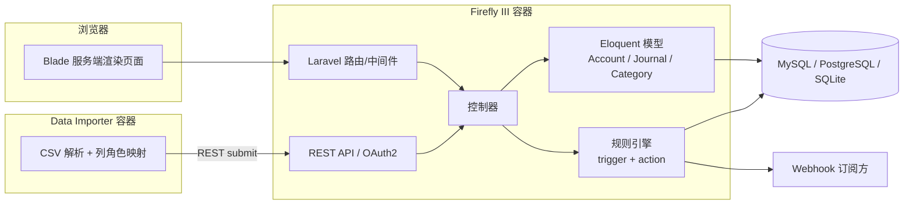
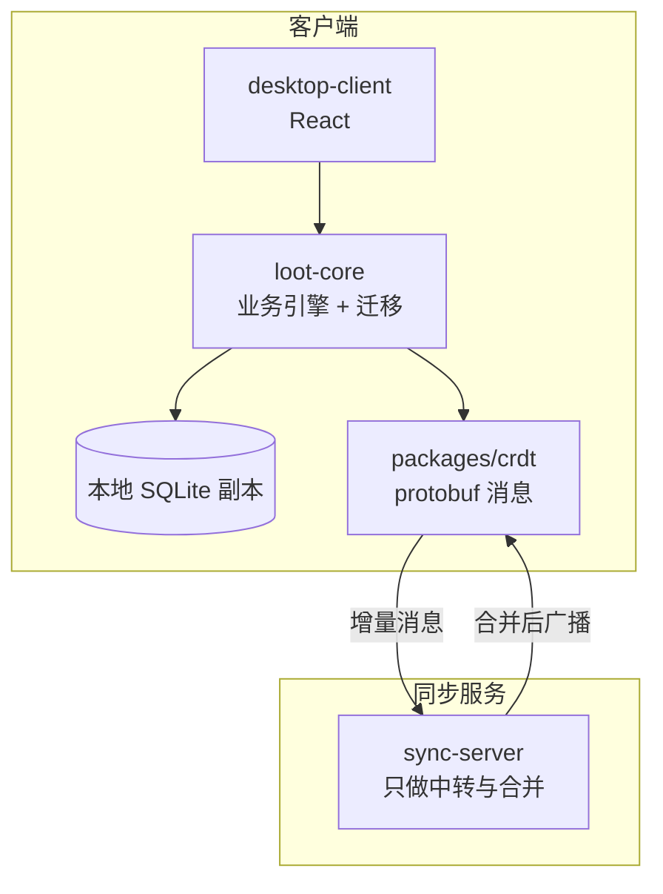
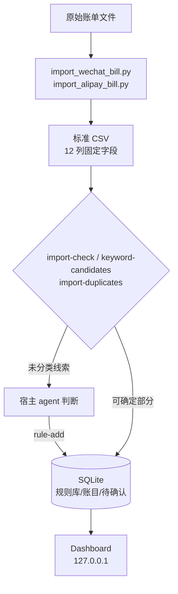
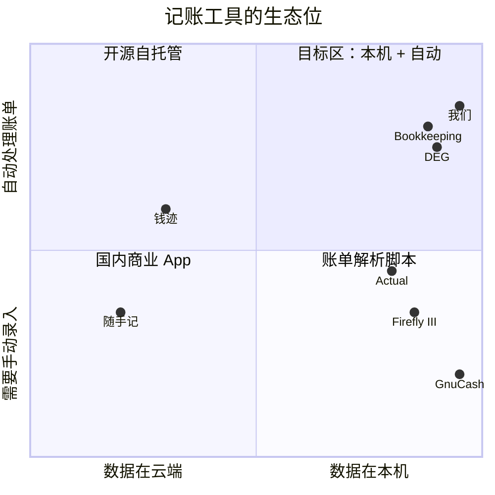
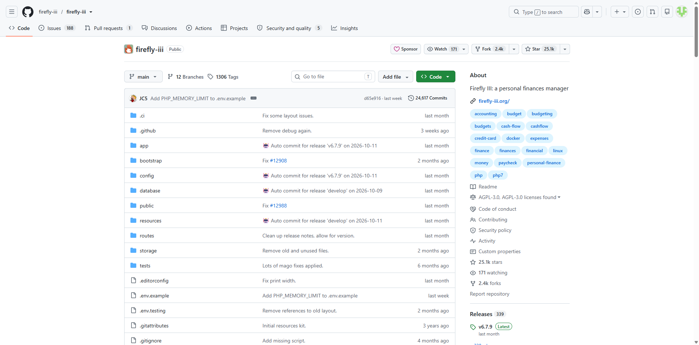
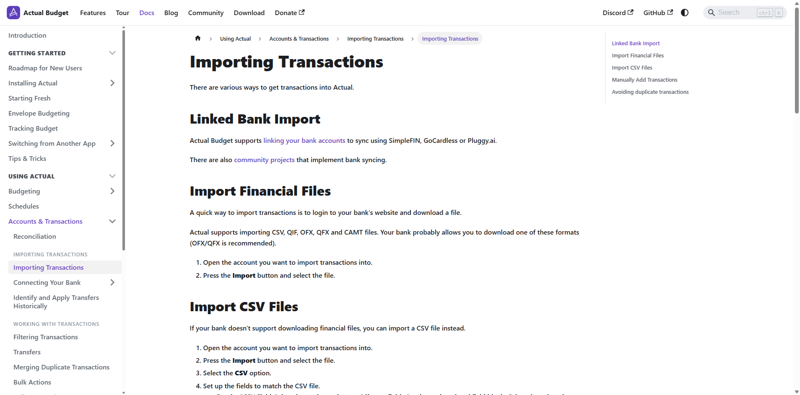
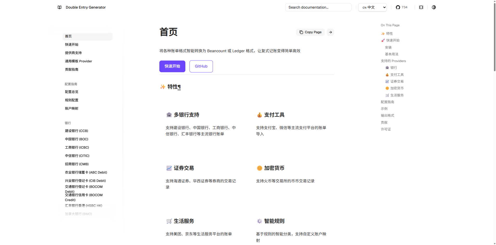
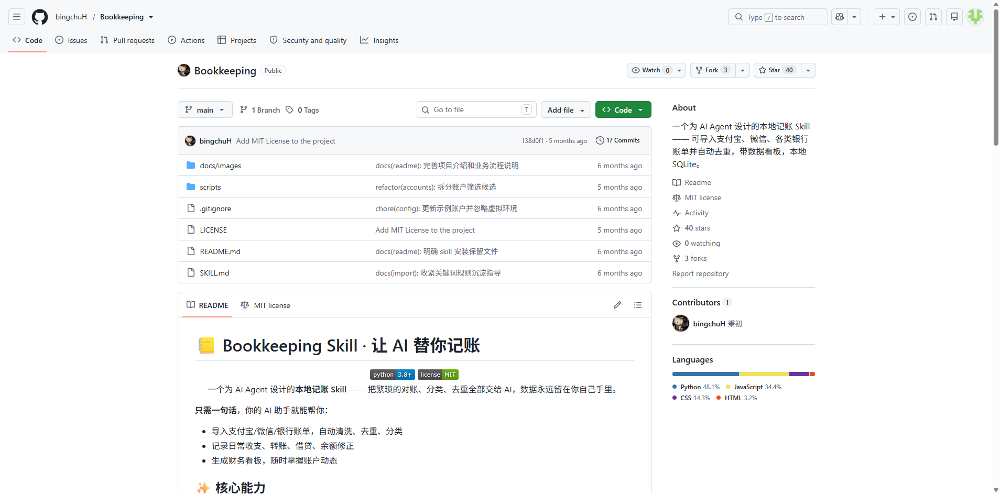
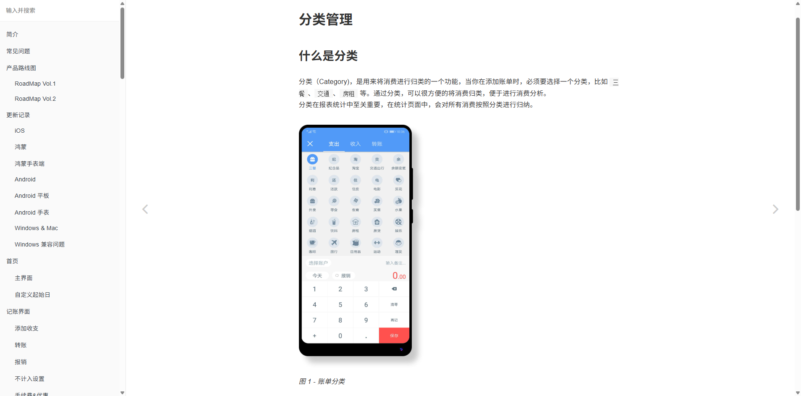
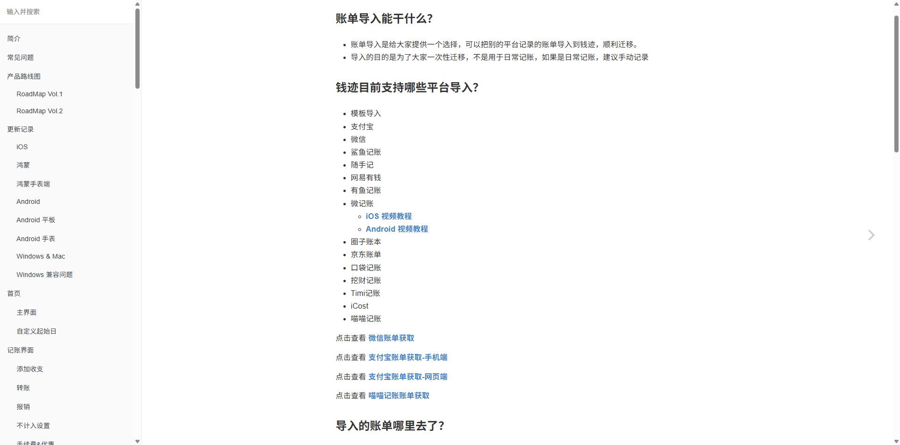

# 本地优先 我的账本工具 · 横纵分析报告

> 研究时间：2026-11-05 | 所属领域：个人财务软件（中国账单场景）| 研究对象类型：拟建产品
> 说明：本文研究对象是「我们准备做的产品」，但产品尚未存在，因此**纵轴写的是这个产品形态的需求前史**，不是虚构我们的发展史。所有历史节点均来自公开来源；无证据处标「暂缺」，推断处标「推断」。
> 调研方式：开源仓库与官方文档走 GitHub API / 官方文档站；国内商业产品只用 ego 浏览器读取公开页面（官网、帮助中心、App Store 公开页、隐私政策），未注册、未登录、未试用。

---

## 一、一句话定义

我们要做的是一个**在本机运行的账单分析工具**：把微信、支付宝导出的账单文件拖进去，它负责解析、去重、排除中性交易、按规则分类（规则未命中时交本地小模型兜底），最后给出一个可信的月度看板。

一句话：**让「导出账单」这个动作直接产出结论，而不是产出又一个待整理的表格。**

它有三条硬边界：只监听 `127.0.0.1`；数据只落本机 SQLite；不做日常手动记账，也不做对话式问账。

---

## 二、纵向分析：需求前史（1997 → 2026）

要理解为什么今天需要这样一个工具，得先看清这个问题被反复定义过多少次。个人记账的需求没有变过——**知道自己把钱花哪儿了**——变的是「记录」这件事由谁承担：人、软件、银行，还是模型。

### 2.1 第一阶段（1997–2008）：把复式记账搬上桌面

个人财务软件的第一个范式是**桌面双式记账**。1997 年 10 月，Robin Clark 的课程作业 X-Accountant 做到了 0.9 版，它后来成了 GnuCash 的起点（一手，GnuCash 官方开发者页；[1]）。

这一代软件解决的是「账要记得对」：科目树、借贷平衡、对账、多币种。GnuCash 至今仍是这个范式的完整实现——账本可以是单文件 XML，也可以是 SQLite/MySQL/PostgreSQL 后端，报表不是查数据库，而是 Scheme 脚本遍历 QOF 对象（一手，GnuCash 5.17 release；[2]）。它的 CSV 导入做得相当细：定宽或分隔符、**编码选项**、日期格式、跳过前后行、导入匹配器（Import Matcher）（一手，GnuCash 文档；[3]）。

但这套模型的代价写在它的门槛里：**类目不是「类目」，是科目**。一笔交易至少两条分录，所谓分类就是另一个科目；收支方向绑定在科目类型上（一手，GnuCash 文档；[3]）。对普通用户，这等于要求先理解会计。

同一时期在 Windows 上占位的是 Money Manager EX（下称 MMEX）。它走的是另一条路：不要求复式记账的概念，**类目支持无限级嵌套**，CSV 导入允许「字段顺序完全自由」——用户逐列告诉软件这是什么字段（一手，MMEX 官方导入文档；[4]）。MMEX 至今没有规则引擎、没有 REST API，2026 年的发布节奏是「一年两三版」（v1.9.4，2026-08-31；[5]）。

这一阶段留下的核心矛盾是：**准确性与易用性不可兼得**。要记得对，就得懂复式记账；要记得快，就只能记流水。

### 2.2 第二阶段（2008–2018）：移动端把「记账」变成内容产品

中国市场的曲线不一样。按公开行业资料，中国记账 App 市场大约从 2008 年起量；随手记创立于 2010 年 5 月，两个月后就成为用户规模最大的记账 App（二手，深圳新闻网 2019 年报道；[6]）。这一代产品的核心不是记账准确，而是**记账体验**：场景化记账（左手拿满东西、右手大拇指也能记完）、预算、账本模板、社区。

结果是一条分叉：

- 一批产品把「记账」做成**内容与流量入口**——理财社区、广告、会员。随手记的隐私政策里至今保留「个性化推荐/广告」条款，且明说「即使本 App 退至后台状态，部分 SDK 经您授权同意仍有可能持续在获取您的个人信息」（一手，随手记隐私政策，更新于 2026-10-26；[7]）。
- 另一批产品把「极简」做成卖点，但在数据上做留存——鲨鱼记账没有账单导入，导出被会员与积分墙层层锁住（一手 App Store 页面 + 二手评测；[8]）。

这一阶段真正的遗产不是功能，而是**数据位置**：账本默认上云，账号即数据，导出是付费功能。我们今天要做的工具，正是对这条默认设置的反弹。

### 2.3 第三阶段（2014–2026）：开源自托管把数据要回来

2014 年 6 月，Firefly III 仓库建立（一手，GitHub API；[9]）。它把「自托管个人财务」做成了一整套完整产品：账户、预算、类目、标签、报表、规则引擎、Webhook、几乎覆盖全部功能的 REST API。它的 README 直接把立场写在开头：No AI, no cloud and privacy-friendly（一手，Firefly III readme；[10]）。

同一年建立的还有 MMEX 的 GitHub 镜像（2014-05），但那只是镜像；真正的新范式发生在 2022 年。Actual Budget 的仓库建于 2022-04-29（一手，GitHub API；[11]），它把**本地优先（local-first）**带进了这个品类：客户端持有一份完整的 SQLite 副本，服务端不做业务计算，只做 CRDT 消息的中转与合并（一手，Actual API 文档；[12]）。同步库是自研的 `@actual-app/crdt`，消息用 protobuf 编码（一手，仓库 README；[13]）。

这一阶段的关键洞察是：**隐私不是一个开关，而是一套架构**。本地优先不是「本地也存一份」，而是「**没有服务器你也能完整工作**」。Actual 的许可证是 MIT（一手，LICENSE.txt；[14]），这也让它成为四个主流开源项目里唯一对闭源二次开发零障碍的一个。

但开源阵营有一块共同的空洞：**没有一个人做中国账单**。Firefly III 的官方导入配置库按国家码分目录，没有 `cn`/`hk`/`tw`（一手，import-configurations 文件树；[15]）；Actual、MMEX、GnuCash 同样不支持微信/支付宝（一手，各自导入文档；[12][4][3]）。

### 2.4 第四阶段（2016–2026）：账单解析器成为独立物种

于是出现了一类不做 UI、只做「账单 → 账本」的工具。

最相关的是 double-entry-generator（下称 DEG）：Go 写的规则驱动导入器，把支付宝/微信/银行账单转成 Beancount 或 Ledger。它的形态很克制——`translate` 命令、YAML 规则、provider/analyser/compiler 三段式，无数据库，文件进文件出（一手，仓库 README；[16]）。

它的实现细节里藏着这个问题的真实难度：

- 支付宝用 **GBK** 解码，表头**硬编码跳过前 22 行**（一手，源码；[17]）。后果是 issue #236：账单头部文本缩进一变，第一笔交易就被吞掉（一手，issue #236；[18]）。
- 微信的「零钱提现」被**强制改成收入**；转账、信用卡还款、零钱充值只被识别为枚举类型，账户仍要用户自己写规则（一手，源码；[19]）。
- 没有内置中文商户规则库，只有示例里的滴滴、苏宁、美团几条（一手，example 配置；[20]）。
- 没有跨文件去重：重复导入同一文件会重复输出（推断，基于源码无账本比对步骤）。

比 DEG 更稳健的是社区项目 china_bean_importers：它不数固定行数，而是**识别表头行**（`交易时间` + `交易分类`），遇到 `------` 结束；对微信的转账、信用卡还款、零钱提现、零钱通转入转出都写了专门分支（一手，源码；[21]）。它同样只声明 GBK，不是 GB18030。

这一阶段的结论很清晰：**账单解析是苦力活，而且苦力活的质量取决于对脏数据的枚举**。谁见过更多的格式变体，谁就更可靠。

### 2.5 第五阶段（2023–2026）：AI 入场，但进场位置各不相同

2023 年之后，「我的账本」成了所有产品的标配词。但拆开看，AI 被放在了三个完全不同的位置：

1. **AI 在录入侧**：截图识别、语音记账、自然语言记一笔。iCost 把截图先 OCR，再把文本传第三方 AI 模型解析，并明确写「可能存在不准确或错误，不对其绝对准确性和可靠性作任何担保」（一手，iCost 隐私政策/帮助中心；[22]）。BeeCount 用 GLM-4 做对话记账与 OCR，本地 TFLite 与云端双引擎（一手，README；[23]）。
2. **AI 在分类侧**：钱迹的「AI 智能匹配」负责把页面文本映射到分类、资产、备注、时间，官方同时承认「AI 大模型本身还是会有一定波动和误差」，且**没有给出任何准确率数字**（一手，钱迹文档；[24]）。
3. **AI 在查询侧**：MoneyWiz 的 WizAI 只读，可问支出、账户、净值、预算；每次发送前要在设备上授权，数据经 MoneyWiz 服务发往 OpenAI，官方写明「无法召回已发送的信息」（一手，MoneyWiz 隐私政策，2026-10-31；[25]）。

与此同时，出现了一个**新物种**：不做 App，做「给 agent 用的记账技能」。2026 年 11 月的 `bingchuH/Bookkeeping` 就是典型——一个 MIT 许可的 Python 技能包，代码只做确定性工作（清洗、去重、规则库、看板），**判断力交给宿主 agent**：让 agent 读未分类账目、提炼关键词规则、写回数据库（一手，SKILL.md；[26]）。

这条路线值得单独看一眼，因为它把「我的账本」的架构问题问到了根上：**如果 agent 已经能读懂账单，产品还需要内置模型吗？**

### 2.6 阶段划分与每阶段的核心矛盾

| 阶段 | 时间 | 代表 | 解决的问题 | 留下的矛盾 |
|---|---|---|---|---|
| 桌面双式记账 | 1997–2008 | GnuCash、MMEX | 记得对 | 准确性与易用性不可兼得 |
| 移动记账 | 2008–2018 | 随手记、鲨鱼记账 | 记得快、有模板 | 数据上云，导出被会员墙锁住 |
| 开源自托管 | 2014–2026 | Firefly III、Actual | 数据主权 | 无中国账单支持；类目模型各有缺陷 |
| 账单解析器 | 2016–2026 | DEG、china_bean_importers、Bean-Sieve | 把导出文件变成条目 | 格式脆弱、去重薄弱、无类目体系 |
| AI 入场 | 2023–2026 | 钱迹、iCost、MoneyWiz、Bookkeeping | 降低录入与分类成本 | 准确率不可证、隐私条款滞后、AI 位置错配 |

把五个阶段串起来看，我们这次要做的东西，本质上是**第四阶段与第三阶段的交叉点**：用「账单解析器」的能力，装进「本地优先应用」的架构里，再把「AI」放在分类兜底这个最不伤信任的位置。

而这三个来源各自都还差一块：

- 解析器有规则、没有产品（DEG 是命令行，Bookkeeping 是给 agent 的技能）；
- 自托管产品有产品、没有中国账单（Firefly/Actual 的导入配置里没有 `cn`）；
- 我的账本有宣传、没有可验证的准确率（钱迹、iCost、MoneyWiz 都明确不承诺）。

---

## 三、横向分析：竞争图谱

### 3.1 分群

按「谁在替用户干活」把竞争面分成四群：

| 群 | 代表 | 替用户干的活 | 与我们的距离 |
|---|---|---|---|
| A. 开源自托管/桌面 | Firefly III、Actual、MMEX、GnuCash | 记账与预算 | 架构参照，无中国账单能力 |
| B. 纯文本记账生态 | beancount、fava、DEG、Bean-Sieve、china_bean_importers | 账单 → 账本条目 | **最接近我们的解析层** |
| C. 国内商业 App | 钱迹、随手记、鲨鱼记账、iCost | 录入与报表 | 类目与导入体验的参照 |
| D. 新物种 | Bookkeeping（agent 技能）、BeeCount、AutoAccounting | 判断 / 采集 | 架构上的直接竞争者 |

### 3.2 A 群：开源自托管与桌面

**Firefly III**（AGPL-3.0，PHP/Laravel，★25,074，v6.7.9 / 2026-10-11）。产品完整度最高：REST API 覆盖几乎全部功能、OAuth2、Webhook、规则引擎（trigger + action + Symfony 表达式）。但它的类目是**单层扁平**——`Category` 模型只有 `name` 与 `color`，没有 parent（一手，Category.php；[27]）。导入靠独立的 Data Importer 容器，按列赋「角色」（Date/Amount/Category/Notes…），**逐列映射而非字段表达式**（一手，roles 文档；[28]）。

它的去重是**内容哈希**：对「映射后、规则前」的交易数组算哈希，改映射或改大小写都会变（一手，duplicate-detection 文档；[29]）。这解释了为什么它的导入文档要求用户先手工删掉前置说明行。

**Actual Budget**（MIT，TypeScript，★29,986，v26.11.0 / 2026-11-02）。架构最值得我们学：本地优先 + CRDT，客户端持全量副本，服务端不做业务计算（一手，API 文档；[12]）。类目是两级：Category group → Category，且只有一个不可删除的 Income 组来隐式表达方向（一手，categories 文档；[30]）。它的规则引擎是四者中最强的：支持正则、`one of`、按字段匹配，**规则分 pre/default/post 三阶段并按具体度自动排序**，还会从用户的改类目动作里自动学习生成规则（一手，rules 文档；[31]）。

它没有 HTTP API，只有 npm 客户端（一手，API 文档；[12]）——这对我们是个提醒：本地优先产品的扩展面，不一定是 REST。

**MMEX**（GPL-2.0，C++/wxWidgets，★2,281，v1.9.4 / 2026-08-31）。唯一提供**无限级嵌套类目**的开源桌面端，CSV 导入允许自由列序（一手，官方文档；[4]）。没有规则引擎、没有 API、没有 Webhook，扩展只能读数据库文件或写外置报表（一手，sitemap 功能清单；[32]）。

**GnuCash**（GPL-2.0-or-later，★4,398，5.17 / 2026-09-27）。科目树 + 方向内建是它的核心优势，也是最重的认知负担。它的 CSV 导入有编码选项与跳过行，去重靠 Import Matcher 的 date + description 启发式（一手，导入文档；[3]）。

### 3.3 B 群：纯文本记账生态——最接近我们的解析层

**beancount + beangulp**（GPL-2.0-only）提供的是**声明式列映射**：`csvbase.Column/Date/Amount` 声明列名，`CSVReader` 有 `encoding` 参数，理论上把编码设为 `gb18030` 就能读支付宝文件（一手，导入文档；[33]）。默认去重是 ±2 天窗口的启发式比较，命中写 `__duplicate__` 元数据（一手，beangulp 源码；[34]）。

**fava**（MIT）只做展示层，BQL 查询、图表、受限于「结果必须恰好两列才能画图」（一手，features 文档；[35]）。

**DEG**（Apache-2.0）是这条线上最成熟的「中国账单 → 复式条目」工具，但它有三处明确短板：硬编码跳行（issue #236 未修）、只认 GBK、没有跨文件去重（一手，源码与 issue；[17][18]）。

**Bean-Sieve**（MIT，0.8.0 / 2026-10-29）补上了去重这一环：它把账单与已有账本按 `(日期, 绝对金额)` 建索引匹配，只输出缺失条目（一手，源码；[36]）。代价是它的自述状态是 Alpha，仓库 2026-03 才建（一手，pyproject；[36]）。

**china_bean_importers**（MIT）在脏数据处理上最细：表头识别而非数行数，微信的中性交易逐类型分支，不确定项打 `confirmation-needed` 标签（一手，源码；[21]）。

这一群给我们的直接可借点有三条：

1. **按表头识别，不按行号跳过**（china_bean_importers 的做法优于 DEG/Bean-Sieve 的硬编码）。
2. **中性交易要按类型枚举**，不能按关键词猜（微信的「零钱提现」「信用卡还款」「零钱通转入转出」各有语义）。
3. **去重要有账本比对**，不能只做文件内去重（Bean-Sieve 的思路）。

### 3.4 C 群：国内商业 App——类目与导入体验的参照

**钱迹**（闭源，★不适用）。类目**两级、可自定义**，默认「其他」不可删，删除分类时账单自动归入「其他」（一手，分类管理文档；[37]）。导入支持微信/支付宝等 14 个来源，但官方明确「导入的目的是为了大家一次性迁移，不是用于日常记账」（一手，导入文档；[38]）。已知短板：**导入不联动账户余额**，需手工调平（一手，同一文档；[38]）。

**随手记**（2010 年创立）。双账本体系（本地账本 + 神象云），神象云支持微信/支付宝导入（二手，少数派横评；[39]）。隐私政策保留个性化广告条款与后台 SDK 采集条款（一手；[7]）。

**鲨鱼记账**。无账单导入，导出被会员/积分墙锁住；订阅 15 元/月、148 元/年（一手 App Store；[8]）。

**iCost**（约 30 元/年）。支持 40+ 平台导入（含微信/支付宝）与两级分类，截图记账走第三方 AI 模型（一手，帮助中心；[40]）。

**MoneyWiz**（$29.99/$59.99 每年）。支持 CSV/QIF/OFX/MT940，**不支持微信/支付宝**；WizAI 只读，数据发往 OpenAI（一手；[25]）。

### 3.5 D 群：新物种——判断力外置

**Bookkeeping（bingchuH）**（MIT，Python）。它把账本做成 SQLite，把「判断」外包给 agent：

- 代码只做确定性工作：清洗、标准 CSV 校验、重复候选生成、关键词规则库、待确认队列、看板。
- agent 负责：读未分类账目、提炼可复用的关键词规则、判断账户别名、写回数据库。
- 它明确写了边界：「不要在对话中临时复刻代码已有的去重、余额、导入或待确认统计逻辑」（一手，SKILL.md；[26]）。

**BeeCount**（BSL，Flutter，★2,739）。本地优先 + 五种同步方案 + 我的账本/OCR/MCP；商业使用需授权（一手，README；[23]）。

**AutoAccounting**（GPL-3.0，Android）。Xposed/无障碍/OCR 三模式，直接 Hook 微信/支付宝或读通知与短信，把账自动记进钱迹、一羽、一木等 App（一手，README；[24b]）。它解决的是「连导出都不用」的极端场景，代价是系统权限。

**Cent**（CC BY-NC-SA 4.0，TS）。纯前端 PWA，用 GitHub 仓库当数据库，支持微信/支付宝导入与 AI 助手（一手，README；[41]）。许可证禁止商业使用，只能当交互参考。

### 3.6 对比矩阵

九列一张表在 A4 上必然挤成竖排，因此按维度拆成三张、以项目为行。

**（1）基本属性**

| 项目 | 许可证 | 形态 | 数据位置 | 技术栈 |
|---|---|---|---|---|
| Firefly III | AGPL-3.0 | 自托管 Web | 自托管 | PHP / Laravel |
| Actual Budget | MIT | 本地优先 Web/桌面 | 本地副本 + 同步服务 | TypeScript |
| MMEX | GPL-2.0 | 桌面 | 本地文件 | C++ / wxWidgets |
| GnuCash | GPL-2.0-or-later | 桌面 | 本地文件或自建 SQL | C/C++ + Scheme |
| double-entry-generator | Apache-2.0 | CLI | 本地文件 | Go |
| Bookkeeping | MIT | Agent 技能 | 本地 SQLite | Python |
| 钱迹 | 闭源 | 移动/桌面 App | 云端 | 未披露 |
| iCost | 闭源 | 移动 App | 云端（iCloud） | 未披露 |
| **我们（拟建）** | 待定 | 本地 Web | 仅本机 | Node / TS |

**（2）账单处理能力**

| 项目 | 微信/支付宝导入 | 编码 | 中性交易 | 去重 / 幂等 |
|---|---|---|---|---|
| Firefly III | ✗ | 暂缺 | 交给规则 | 内容哈希（改映射即失效） |
| Actual Budget | ✗ | 暂缺 | 交给规则 | id + 日期金额模糊匹配 |
| MMEX | ✗ | 暂缺 | 无 | 暂缺 |
| GnuCash | ✗ | 有编码选项 | 手工 | date + description 启发式 |
| double-entry-generator | ✓ | GBK | 部分枚举，不自动配对 | 无 |
| Bookkeeping | ✓ | 由 agent 清洗 | 有语义分类 | 重复候选 + 人工确认 |
| 钱迹 | ✓（14 个来源） | 暂缺 | 有 | 有「重复账单识别」 |
| iCost | ✓（40+ 平台） | 暂缺 | 有 | 暂缺 |
| **我们（拟建）** | ✓ | ✓（GB18030） | ✓ 不计收支 | 唯一键 + 弱去重标记 |

**（3）分类与 AI**

| 项目 | 类目层级 | 规则引擎 | 内置模型 | 备注 |
|---|---|---|---|---|
| Firefly III | 单层 | ✓ trigger + action | ✗ | 无中国区导入配置 |
| Actual Budget | 2 层（组 → 类目） | ✓✓ 三阶段 + 自动学习 | ✗ | 无 HTTP API |
| MMEX | 无限级 | ✗ | ✗ | 无 API / 无 Webhook |
| GnuCash | 科目树任意深度 | ✗ | ✗ | 科目类型绑定收支方向 |
| double-entry-generator | 账户树 | ✓（YAML） | ✗ | 无商户规则库 |
| Bookkeeping | 自定义树 | ✓（关键词沉淀） | ✗（用宿主 agent） | 判断力外置 |
| 钱迹 | 2 层 | 部分 | ✓（云端） | AI 不给准确率 |
| iCost | 2 层 | 部分 | ✓（云端） | 明确不担保准确性 |
| **我们（拟建）** | 2 层（调研后定） | ✓ 规则优先 | ✓ 本地 1B | 模型只兜底 |

### 3.7 四个重点项目的架构图

**Firefly III：单体 + 独立导入器**

关键结论：导入与主应用是**两个进程**；去重发生在主应用侧，按「映射后、规则前」的交易数组哈希（一手，duplicate-detection 文档；[29]）。

**Actual Budget：本地优先 + CRDT**

关键结论：**服务器不做业务计算**，客户端持有全量数据；同步消息 protobuf 编码，支持端到端加密（一手，API 文档与 crdt README；[12][13]）。

**double-entry-generator：三段式管道**

关键结论：无持久化、无账本比对，因此**重复导入必然重复输出**；规则是 YAML，可匹配 type/category/peer/item/method/time/金额区间（一手，README 与规则文档；[16][20]）。

**Bookkeeping：代码做确定性工作，agent 做判断**

关键结论：它把「需要判断的部分」显式留在 agent 侧，代码只保证不重复、不丢账；这正是「AI 位置」的另一种答案（一手，SKILL.md；[26]）。

### 3.8 类目体系横评

| 项目 | 层级 | 方向表达 | 默认类目 | 删除/改名的影响 |
|---|---|---|---|---|
| Firefly III | 单层 | 交易类型决定 | 暂缺（推断无预置） | 类目只是标签，改名不影响交易 |
| Actual | 2 层（组 → 类目） | 靠唯一的 Income 组 | 暂缺 | 类目可合并/隐藏 |
| MMEX | 无限级 | 交易字段决定 | 暂缺 | 未文档化 |
| GnuCash | 科目树任意深度 | **科目类型决定** | 无（有示例账套） | 科目改名走复式账务规则 |
| 钱迹 | 2 级 | 收支类型 | 暂缺（「其他」不可删） | 删除后账单归「其他」，**不能指定迁移目标**（一手；[37]） |
| iCost | 2 级 | 收支类型 | 暂缺 | 可归档、可批量编辑（一手；[40]） |
| **我们** | 2 级 | 一级类目绑定收入/支出 | 待调研后定 | 改名不漂移历史；删除需指定迁移目标 |

结论：**「一级类目绑定收支方向」这一点，在 A/B 群里没有对标实现**——Firefly 与 MMEX 把方向放在交易上，Actual 用 Income 组隐式表达，GnuCash 用科目类型表达。我们可以直接采用商业 App 的直觉（一级类目即方向），同时保留开源产品的可迁移性（改名不漂移）。

### 3.9 生态位

把「数据位置」与「是否自动处理中国账单」两个维度画开：

右上角（本机 + 自动处理账单）目前几乎是空的：DEG 与 Bookkeeping 在自动化上够强，但一个没有 UI、一个没有内置模型，都需要用户具备额外条件。

---

### 3.10 取证截图（ego 浏览器，2026-11-05）

以下截图由 ego 浏览器对公开页面实地抓取，用于证明「文档写了什么」而不是转述。Firefly III 官网 `firefly-iii.org` 触发了 Cloudflare 人机验证（页面标题为「请稍候…」），因此改用其 GitHub 仓库页取证，未尝试绕过验证。

**图 1｜Firefly III 仓库页**——README 原文 "No AI, no cloud and privacy-friendly"

**图 2｜Actual Budget 导入文档**——支持 CSV/QIF/OFX/QFX/CAMT，逐字段选列

**图 3｜double-entry-generator 文档首页**——支付平台支持与规则式分类

**图 4｜Bookkeeping 仓库页**——「为 AI Agent 设计的本地记账 Skill」

**图 5｜钱迹·分类管理**——两级分类、可自由增删改、「其他」不可删

**图 6｜钱迹·账单导入**——支持支付宝/微信等 14 个来源，官方称「用于一次性迁移」

---

## 四、横纵交汇：为什么是现在，为什么是这个形状

### 4.1 历史如何塑造了当下的竞争位置

三条历史线索在今天交汇：

1. **桌面双式记账留下了「准确」的基因，也留下了门槛。** 复式记账保证了结论可信，但要求用户理解借贷。开源自托管继承了这套模型（Firefly 的 journal/transaction 二分、GnuCash 的科目树），所以它们在中国用户面前先输在概念上。
2. **移动记账留下了「体验」的基因，也留下了数据默认上云。** 随手记、鲨鱼记账把记账做成内容产品，导出被设计成留存杠杆。这直接决定了今天「本地优先」是一个卖点而不是默认值。
3. **解析器留下了「脏数据知识」，但没有留下产品。** DEG、china_bean_importers、Bean-Sieve 各自踩过支付宝表头缩进、微信中性交易、GBK 解码的坑。这些知识散落在源码与 issue 里，没有变成一个用户能直接用的东西。

我们的位置，就是把第 3 条的知识装进第 2 条教训所要求的数据架构里，再用第 1 条的严谨性约束结论口径。

### 4.2 优势与劣势的历史根源

**我们的优势，全部来自「后发」：**

- 没有历史数据模型包袱，可以直接采用「整数分 + 唯一键 + 分类来源字段」这种只在新项目里才成立的干净设计。
- 可以直接吸收 DEG/Bean-Sieve/china_bean_importers 三份踩坑记录，尤其是「按表头识别」与「中性交易按类型枚举」。
- 可以把模型放在分类兜底这种低风险位置，而不是像钱迹/iCost 那样放在录入主路径上（那里错误代价最高）。

**我们的劣势，也全部来自「后发」：**

- **没有规则库积累**。DEG 没有内置商户库，我们同样没有；规则库是需要用真实数据一条条长出来的资产。
- **去重仍然脆弱**。Firefly 的内容哈希、Actual 的模糊匹配、Bean-Sieve 的日期+金额索引，都证明了这件事没有银弹。我们的「唯一键 + 弱去重标记」在跨月重叠导出上仍然需要人工兜底。
- **小模型的天花板**。MiniCPM-V 4.7 的 1B 档在中文商户名上的分类准确率不可证，且这台机器（16 GB 内存、MX250 2 GB 显存）跑不动 35B-A3B。这意味着**准确率主要由规则承担**，模型只是减少「未分类」的数量。

### 4.3 三个剧本

**最可能的剧本（60%）**：我们把「导入 → 去重 → 中性排除 → 规则分类 → 看板」这条链路做扎实，模型只在 5%–15% 的未命中项上工作，用户看到的是「月度支出 N，其中餐饮占比 X%」，而不是一堆待确认。规则库随使用增长，三个月后模型调用量趋近于零。

**最危险的剧本（30%）**：解析器在真实账单上不断翻车——支付宝表头变化、微信备注里有换行与引号、退款与转账混在中性交易里。用户每次导入都要手工修数据，工具沦为「比 Excel 好一点」。DEG 的 issue #236 与 Firefly 的「必须手工删前置行」都在提示这个风险。

**最乐观的剧本（10%）**：这套「账单 → 结论」的链路被证明足够稳，它可以从「我自己的工具」长成「给同样处境的人用的工具」，甚至变成像 Bookkeeping 那样的 agent 技能形态——同一套解析与去重代码，两种外壳。

### 4.4 该造、该改，还是该借？

按调研结果，**没有一个现成项目可以直接下载来改造**，原因分别是：

| 候选 | 为什么不能直接用 |
|---|---|
| Firefly III | AGPL-3.0（改造成服务会被传染）+ PHP/Laravel 技术栈 + 单层类目 + 无中国账单配置 |
| Actual Budget | MIT 可改造，但**没有 HTTP API**，且 TS/loot-core 的 CRDT 架构与「本地单进程」目标不匹配；类目模型是信封预算，不是消费分析 |
| MMEX / GnuCash | GPL + C++/C，改造成本高于重写；无规则引擎 |
| DEG | Go + 输出文本账本，没有 UI 与持久化；硬编码跳行、无去重 |
| Bean-Sieve | Alpha、输出 Beancount、无 UI；去重是日期+金额 |
| Bookkeeping | **最接近**，但它是给 agent 的 CLI 技能包，无 UI、无内置模型，且是 Python；与我们的 Node/TS 栈不一致 |
| 钱迹 / iCost | 闭源，不可改；但类目与导入体验值得照抄 |
| BeeCount | BSL（商用需授权）+ Flutter |
| Cent | CC BY-NC-SA（禁止商用）+ GitHub 当数据库 |

结论分三层：

1. **代码层：不 fork，只借三处实现思路**——按表头识别（china_bean_importers）、中性交易按类型枚举（同上）、账本比对式去重（Bean-Sieve）。
2. **产品层：照抄商业 App 的两条直觉**——一级类目即收支方向、导入后必须能一眼看出「哪些没分类」。
3. **架构层：抄 Actual 的一条原则**——**没有服务器也要能完整工作**；以及抄 Bookkeeping 的一条边界——**把判断与确定性工作分开**。

这也回答了你最初的问题「有没有特别好的项目，我们不用自己造」：**有一半的好项目**。解析逻辑可以借鉴得很彻底，但要一个「本机跑、有界面、自带兜底模型、认中国账单」的成品，目前不存在。

---

## 五、信息来源

> 全部访问于 2026-11-05。标注「一手」者为官方仓库/文档/许可证/隐私政策原文。

[1] GnuCash 官方开发者页（X-Accountant 0.9，1997-10）：https://code.gnucash.org/website/docs/v1.6/C/x16.html
[2] GnuCash 5.17 release：https://github.com/Gnucash/gnucash/releases/tag/5.17
[3] GnuCash 导入文档：https://github.com/Gnucash/gnucash-docs/blob/stable/C/guide/ch_importing.docbook
[4] MMEX 导入导出文档：https://moneymanagerex.org/docs/features/importexport/
[5] MMEX v1.9.4：https://github.com/moneymanagerex/moneymanagerex/releases/tag/v1.9.4
[6] 随手记创立时间（二手，2019 报道）：http://www.sznews.com/banking/content/2019-03/22/content_21496512.htm
[7] 随手记隐私政策：https://www.sui.com/help/privacy.jsp
[8] 鲨鱼记账 App Store 页：https://apps.apple.com/cn/app/id1079718756
[9] Firefly III 仓库元数据：https://api.github.com/repos/firefly-iii/firefly-iii
[10] Firefly III readme：https://github.com/firefly-iii/firefly-iii
[11] Actual 仓库元数据：https://api.github.com/repos/actualbudget/actual
[12] Actual API 文档：https://actualbudget.org/docs/api/
[13] Actual CRDT README：https://github.com/actualbudget/actual/blob/master/packages/crdt/README.md
[14] Actual LICENSE.txt：https://github.com/actualbudget/actual/blob/master/LICENSE.txt
[15] Firefly 导入配置库（无 cn/hk/tw）：https://data.jsdelivr.com/v1/packages/gh/firefly-iii/import-configurations@main
[16] DEG README：https://github.com/deb-sig/double-entry-generator
[17] DEG 支付宝 provider 源码：https://github.com/deb-sig/double-entry-generator/blob/master/pkg/provider/alipay/alipay.go
[18] DEG issue #236：https://github.com/deb-sig/double-entry-generator/issues/236
[19] DEG 微信 provider 源码：https://github.com/deb-sig/double-entry-generator/blob/master/pkg/provider/wechat/parse.go
[20] DEG 示例规则：https://github.com/deb-sig/double-entry-generator/blob/master/example/alipay/config.yaml
[21] china_bean_importers 源码：https://github.com/jiegec/china_bean_importers
[22] iCost 隐私政策：https://help.icostapp.com/guide/law/privacy.html
[23] BeeCount README：https://github.com/TNT-Likely/BeeCount
[24] 钱迹 AI 自动记账文档：https://docs.qianjiapp.com/blogs/improve_ai_match.html
[24b] AutoAccounting README：https://github.com/AutoAccountingOrg/AutoAccounting
[25] MoneyWiz 隐私政策：https://www.wiz.money/support/privacy-policy
[26] Bookkeeping SKILL.md：https://github.com/bingchuH/Bookkeeping/blob/main/SKILL.md
[27] Firefly Category 模型：https://cdn.jsdelivr.net/gh/firefly-iii/firefly-iii@main/app/Models/Category.php
[28] Firefly 导入 role 文档：https://github.com/firefly-iii/docs/blob/main/docs/docs/references/data-importer/roles.md
[29] Firefly 去重文档：https://github.com/firefly-iii/docs/blob/main/docs/docs/references/data-importer/duplicate-detection.md
[30] Actual 类目文档：https://actualbudget.org/docs/budgeting/categories/
[31] Actual 规则文档：https://actualbudget.org/docs/budgeting/rules/
[32] MMEX 功能清单（sitemap）：https://moneymanagerex.org/sitemap.xml
[33] beancount 导入文档：https://beancount.github.io/docs/importing_external_data/
[34] beangulp 去重源码：https://github.com/beancount/beangulp/blob/master/beangulp/importer.py
[35] fava features：https://github.com/beancount/fava/blob/main/src/fava/help/features.md
[36] Bean-Sieve 源码与 pyproject：https://github.com/Xm798/bean-sieve
[37] 钱迹分类管理文档（浏览器取证，截图见 assets）：https://docs.qianjiapp.com/fen-lei-guan-li.html
[38] 钱迹账单导入文档（浏览器取证，截图见 assets）：https://docs.qianjiapp.com/other/import_guide2.html
[39] 少数派记账 App 横评（二手）：https://sspai.com/post/98549
[40] iCost 导入与会员文档：https://help.icostapp.com/guide/import/import.html
[41] Cent README：https://github.com/glink25/Cent

### 方法论说明

本文使用横纵分析法（Saussure 的历时-共时分析 + 纵向-横截面研究设计 + 竞争战略分析的组合）：纵轴沿时间还原需求与产品的演化，横轴在当前时间切面上做同类对比，最后交叉两条轴给出判断。方法论由数字生命卡兹克提出，说明见 khazix-skills 仓库的 `hv-analysis`。
