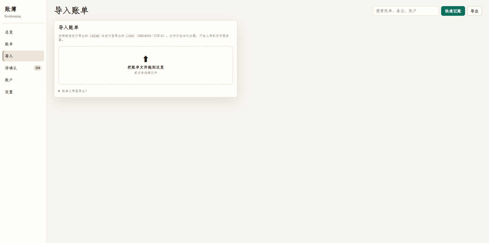
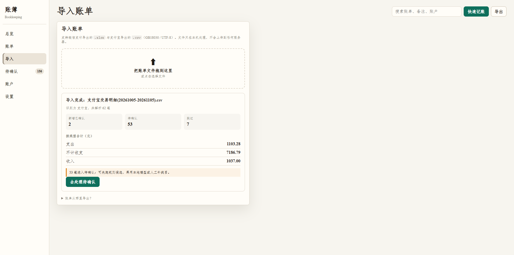

# 使用说明

## 访问地址

| 场景 | 地址 |
|---|---|
| 本机 | `http://127.0.0.1:8765` |
| 手机 / 外网 | `<你的域名>`（Cloudflare Tunnel） |

打开后需要登录。账号由管理员创建；首次部署时管理员初始密码打印在服务日志里
（也可在 `myledger.toml` 的 `[admin]` 段固定）。

## 前提

- Python 3.13，且已安装 `openpyxl`（`pip install openpyxl`）。
- 真实账单放在 `data/`（已 gitignore，永不入库）。

## 一、初始化

```sh
python -m app init
```

默认数据库位置：`~/.local/share/bookkeeping/bookkeeping.db`。想放别处就设环境变量：

```sh
BOOKKEEPING_DB_PATH=E:/path/to/ledger.db python -m app init
```

## 二、在网页里导入（推荐）

打开 `http://127.0.0.1:8765` → 左侧「导入」→ 把账单文件拖进方框。




- 支持：微信支付导出的 `.xlsx`、支付宝导出的 `.csv`（GB18030 / UTF-8），以及**微信导出的加密 `.zip`**。
- 传 zip 时会先要求填写密码（微信「下载账单 → 用作个人对账」的密码由微信支付公众号下发）；密码错误会明确提示并允许重输，不用重新选文件。
- 数据源按**文件内容**识别，不看文件名；识别不了会明确告诉你支持哪些格式。
- 文件只在本机处理：解析在服务进程内完成，生成的临时标准 CSV 导入后立即删除。
- 导入后立刻看到：识别来源、解析笔数、新增已确认、待确认、跳过，以及按类型合计。




重复导入同一文件不会产生重复记录。

## 三、用命令行导入（可选）

需要脚本化或批量导入时：

```sh
python app/import_wechat_bill.py "data/微信账单.xlsx" --output /tmp/wechat.csv
python app/import_alipay_bill.py "data/支付宝账单.csv" --output /tmp/alipay.csv
python app/bookkeeping.py import /tmp/wechat.csv
python app/bookkeeping.py import /tmp/alipay.csv
```

## 四、补类目

规则优先。规则未命中的条目进入「待确认」队列，由人工确认；
确认时勾选「学习关键词规则」，下次遇到相同商户就会自动分类。

```sh
# 看还有多少没分类、有哪些可沉淀的关键词
python app/bookkeeping.py keyword-candidates /tmp/wechat.csv
```

也可以在网页「待确认」页逐条处理：左边是概览，右边是卡片，
每张卡片给出建议类目，确认或改选后即生效。

> 代码里保留了可选的本地模型分类入口（`classify-pending`），
> 但它**当前未启用**：需要自行部署 `llama-server` 并在 `myledger.toml` 里配置端点。
> 不配置也能完整使用——分类靠规则库 + 人工确认收敛。

## 五、看板

```sh
python -m app
```

打开 `http://127.0.0.1:8765`。看板只监听回环地址。

首页分三块：

| 位置 | 内容 |
|---|---|
| 左侧装订脊 | 账本名、最近 6 个月（行背景宽度即该月支出，点击跳月）、功能入口 |
| 中间 | 连续流水：按日分组，每笔一行；跨月处插入当月合计 |
| 右侧汇总 | 本期结余、收入/支出/笔数、支出结构环形图（可切大类/小类）、待确认入口 |

右上角「仅流水 / 流水 + 汇总」可收起汇总面板；窄屏下汇总改到流水上方，底部换成导航条。

## 六、从邮箱收账单

微信和支付宝都能把账单发到邮箱，但两种形态不同：

| 来源 | 邮件形态 | 应用怎么处理 |
|---|---|---|
| 支付宝 | **zip 附件** | 直接保存到待导入目录 |
| 微信 | **「点击下载」链接** | 按域名白名单识别，点收取时一并下载 |

### 配置（每个用户各配各的）

设置 → 邮箱收取：

```
邮箱账号：你的QQ号@qq.com
授权码：  QQ 邮箱的 16 位授权码（不是登录密码）
[保存]
```

拿授权码：QQ 邮箱网页版 → 设置 → 账号 → 开启 IMAP/SMTP 服务 → 按提示发短信 → 生成授权码。

授权码用 AES-GCM 加密后存在数据库里，主密钥在 `myledger.toml` 的 `[mail].secret_key`。
**主密钥丢了需要重新填授权码**，但不会导致历史账目丢失。

### 租充电宝归到哪个分类

用 **其他 / 租赁**。租充电宝、租雨伞、共享设备这类临时租用服务都归这里。

不放在「交通」下：充电宝不是出行成本，混进去会让交通占比虚高。

已配好自动命中的关键词，导入时不用手动选：
`充电宝`、`怪兽充电`、`街电`、`小电`、`来电科技`、`租借`、`租赁`。

### 帮人买东西收到的钱归到哪个分类

用 **收入 / 代收代付**。典型场景：帮同事代买、替家人垫付后对方把货款转过来。

为什么不用「退款」：「退款」是商家把钱退给你，属于自己钱的回流；
「代收代付」是别人的钱过你的手，经济实质不同。

注意这一项**仍会计入收入合计**（月度汇总把 `收入` 类型全部算进去）。
如果某笔金额大、不想让它抬高收入数字，可以在「账单」页把类型改成
`收款 / 垫付款收回`——那个类型不算收入。

### 支持哪些账单

| 来源 | 格式 | 说明 |
|---|---|---|
| 微信支付 | `.xlsx` | 可加密 zip；密码见微信支付公众号 |
| 支付宝 | `.csv` | GB18030 编码 |
| 美团 | `.csv` | UTF-8；解压密码在美团的申请记录页 |
| 抖音支付 | `.pdf` | 解压密码在抖音的申请记录页 |

跨平台重复（同一笔消费同时出现在微信和美团账单里）**无法自动识别**，
因为两边的交易单号不同。看到重复时，在待确认卡片上点「删除」清掉多出来的那条。

### 话费归到哪个分类

「冲话费」属于 **居家 / 手机电话**（通讯支出）。导入时按关键词自动命中，已配好这些规则：

| 关键词 | 分类 |
|---|---|
| 话费、充话费、手机充值、流量包 | 居家 / 手机电话 |
| 中国移动、中国电信、中国联通、移动、电信、联通 | 居家 / 手机电话 |
| 宽带 | 居家 / 手机电话 |

关键词是**子串匹配**：交易对象里包含该词就算命中，所以「广东联通」「移动话费」都能识别。
规则在「设置 → 分类规则」里可以增删。

### 收取（手动触发，不轮询）

导入页 → 点「从邮箱收取附件」。扫描规则：

- 只扫**最近 7 天**的未读邮件（可在 `[mail].scan_days` 调整），不会把历史未读全翻一遍
- 处理过的邮件标记为已读，不会重复提取
- 只看真 zip：伪装成 `.zip` 的追踪像素会被跳过
- 主题里没有「账单」但确实带了 zip 的邮件也会收
- 正文里的埋点链接（如支付宝的 `bi.do` 追踪像素）不会被当成账单下载链接
- 支持链接型邮件自动下载：微信（`tenpay.wechatpay.cn`）、支付宝（`bill.alipay.com`）

收完后，待导入的压缩包列在下方，每行两个按钮：

- **导入**：点开后在行内填解压密码（没加密留空）→ 点「开始导入」。导入成功会自动删掉该压缩包，避免重复导入。
- **删除**：邮件里的附件不一定都是想要的，不需要的直接删掉。

导入结果会显示 `解析 N 笔 · 已确认 N · 待确认 N · 去重 N`。没有命中分类规则的记录会进入「待确认」页，
那里可以补类目。

## 七、备份

服务启动时会自动备份一次，之后每 60 分钟一次；保留最近 14 份。

```bat
myledger backup        :: 手动立即备份
```

备份位置默认是数据库同级的 `backups/`，可在 `myledger.toml` 的 `[backup]` 段调整：

```toml
[backup]
enabled = true
directory = "E:/ai/apps/myledger/data/backups"
keep = 14
interval_minutes = 60
```

恢复方式：停服务 → 把某个 `ledger-YYYYMMDD-HHMMSS.db` 覆盖 `data/ledger.db` → 启动。

## 八、多用户

每个用户的账目、账户、分类规则互相隔离，只能看到和修改自己的。

- **管理员**：设置页能看到「用户管理」，可建号、重置密码、启用/禁用、改角色、删除。
  硬规则：不能禁用/降级/删除自己，不能动最后一个管理员。
- **普通用户**：只能改自己的密码，看不到用户管理入口。
- **账本范围**：管理员在顶部可切换「我的账本 / 全部账本」；普通用户没有这个开关，传 `scope=all` 也无效。
- **禁用即失效**：禁用某个用户会立刻作废他所有设备的登录态。

## 九、手机上使用

1. 手机浏览器打开 `<你的域名>`
2. 菜单里选「添加到主屏幕」
3. 从主屏幕图标打开即为全屏（无地址栏）

底部导航依次是：总览 / 账单 / 导入 / 待确认 / 账户 / 设置。

## 十、常见问题

**点「确认」没反应？**
- 中性交易（`不计收支`、`转账`）没有分类可选项，直接点「确认」即可，这是正常的。
- 支出/收入必须选分类，否则状态栏会提示「请先选择分类」。
- 若状态栏什么都没有，先确认页面没有报错；服务端日志会记录每个请求。

**收取邮件时提示「需要用授权码而不是登录密码」？**
QQ 邮箱要在网页版开启 IMAP 服务并生成授权码，登录密码不能用于 IMAP。

**点了「收取附件」但没有文件？**
- 只扫描未读邮件；已读的不会重复处理。
- 微信的下载链接 7 天内有效，过期要重新申请账单。

**登录后立刻跳回登录页？**
- 若通过明文 HTTP 访问，`Secure` cookie 不会被浏览器发送。生产环境请走 HTTPS（`<你的域名>`）。

**忘记管理员密码？**
- 在服务器上直接重置（需要能访问数据库文件）：
  `python -c "import sqlite3,sys; sys.path.insert(0,'.'); from app import auth; c=sqlite3.connect('data/ledger.db'); c.row_factory=sqlite3.Row; auth.set_password(c,1,'新密码')"`

**启动时报「已被占用」？**
已有 `myledger` 在跑。关掉它，或换端口启动：

```bat
myledger.exe --config myledger.toml --port 8766
```

## 七、已知偏差

- 退款不做冲销：退款按收入计入，可能让「支出」偏高、分类占比失真。
- 跨平台重复（微信 ↔ 支付宝 ↔ 银行卡）不自动配对：同一笔钱在两边各出现一次时，会被算两次。
- 中性交易不进收支合计，但会计入账户余额变动。
